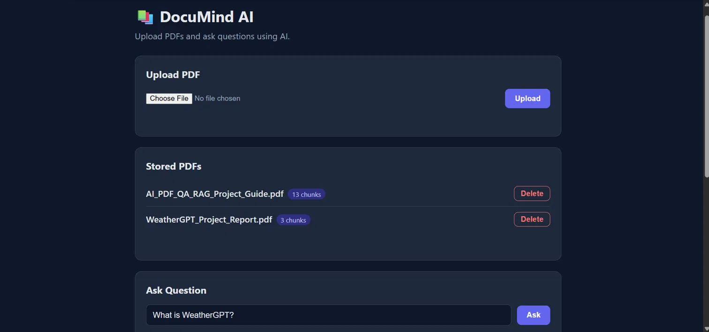
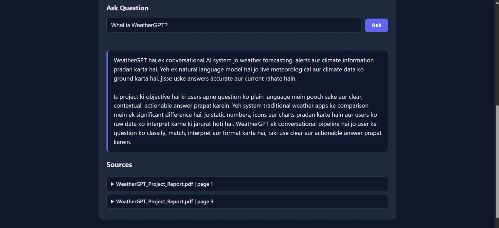
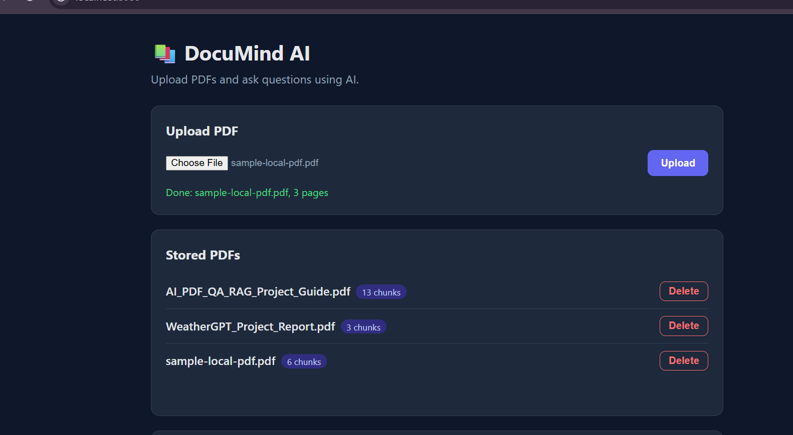
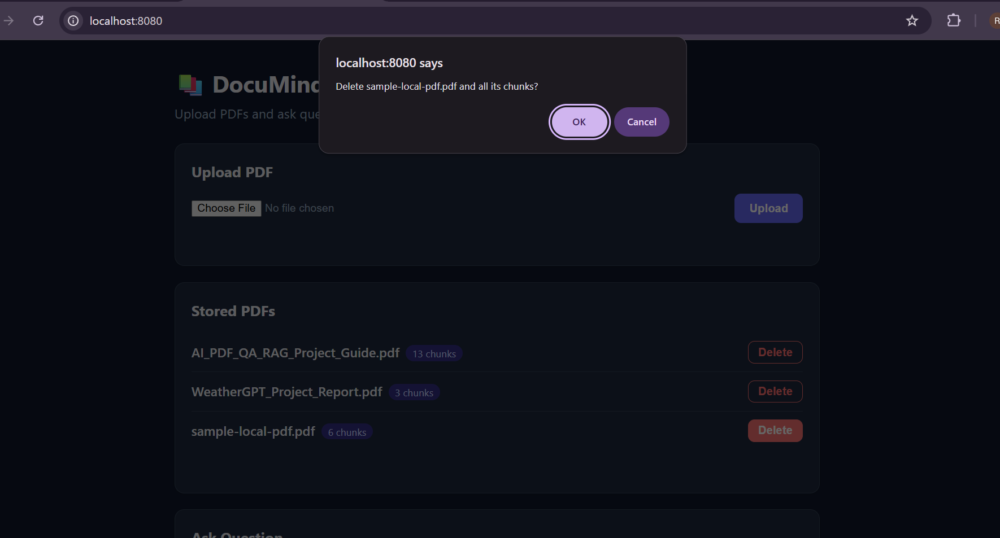
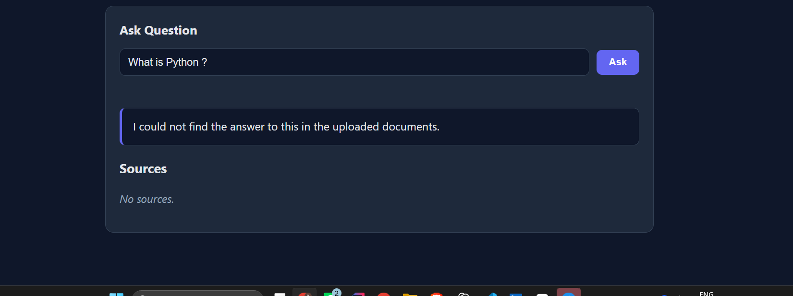
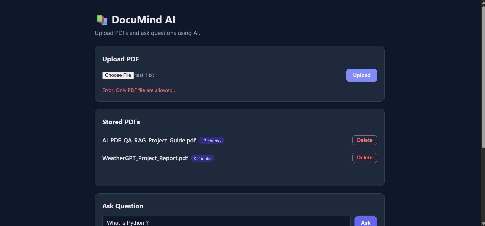

# DocuMind AI

A Retrieval-Augmented Generation (RAG) application built with **Java, Spring Boot and Spring AI**, with a simple web interface.
Upload a text-based PDF, ask questions about it, and get an answer generated from the retrieved parts of that PDF, along with the file and page numbers it came from.

Everything runs locally and for free: the language models run on **Ollama** and the vectors are stored in **PostgreSQL with pgvector**.

## Screenshots

**Upload PDFs and manage them**



**Ask a question and see the answer with its sources**



**Upload a PDF and see it in the stored list**



**Delete asks for confirmation**



**When the answer is not in the PDFs**



**A wrong file type shows a clear error**



## Architecture

**Frontend communicates with Spring Boot REST APIs**

HTML, CSS, JavaScript → Spring Boot → PDF Processing → Embeddings (Ollama) → PostgreSQL + pgvector

**Question answering flow**

User Question → Semantic Search → Relevant Chunks → Ollama (llama3.2:3b) → Answer with Sources

## Why RAG

A general language model has never seen your PDF, and when it does not know something it may invent an answer. RAG fixes this by first **retrieving** the relevant chunks of your document, then giving only those chunks to the model as context, so the answer stays grounded in the document.

## Features

- Upload a PDF and extract its text page by page
- Clean and split the text into chunks, keeping page number and file name as metadata
- Generate embeddings for each chunk and store them in pgvector
- Semantic search: finds chunks by meaning, not by exact keywords
- Ask a question and receive an answer plus the sources (file name and page) it was based on
- Similarity threshold: if no chunk is similar enough, the model is not called and the API replies that the answer was not found
- Re-uploading the same file replaces its old chunks instead of creating duplicates
- List all stored PDFs and delete one by file name
- Clear JSON error responses through a global exception handler
- Database credentials kept out of the code (`.env` and environment variables)
- Web interface: upload, list, delete, ask, and expandable sources, with a loading indicator and light and dark themes

## Tech stack

| Part | Technology |
|---|---|
| Language | Java 21 |
| Framework | Spring Boot 4.1.1 |
| AI toolkit | Spring AI 2.0.1 |
| Chat model | `llama3.2:3b` (Ollama) |
| Embedding model | `nomic-embed-text` (Ollama, 768 dimensions) |
| Vector database | PostgreSQL 17 + pgvector (Docker) |
| Frontend | HTML, CSS and JavaScript (fetch), no framework |
| Build tool | Maven |
| API testing | Postman |

## How it works

**1. Upload (ingestion), runs once per PDF**

```
PDF -> extract text per page -> clean spaces -> split into chunks
    -> embeddings (nomic-embed-text) -> store text + metadata + vector in pgvector
```

**2. Ask (query), runs for every question**

```
Question -> embedding -> similarity search in pgvector (top 4, threshold 0.65)
         -> build prompt (instructions + context + question)
         -> llama3.2:3b -> answer + sources
```

## Project structure

```
src/main
├── java/com/example/documinai
│   ├── DocuMindAiApplication.java
│   ├── controller
│   │   ├── DocumentController.java        REST endpoints
│   │   └── GlobalExceptionHandler.java    turns errors into clear JSON
│   ├── service
│   │   ├── PdfExtractionService.java      validates and reads PDFs
│   │   └── DocumentService.java           list, exists and delete logic
│   └── dto
│       ├── UploadResponse.java
│       ├── SearchResult.java
│       ├── AnswerResponse.java
│       ├── DocumentInfo.java
│       └── ErrorResponse.java
└── resources
    ├── application.properties
    └── static                             web interface, served by Spring Boot
        ├── index.html
        ├── css/style.css
        └── js/app.js
```

## Prerequisites

- Java 21 or newer
- Maven (or use the included `mvnw` wrapper)
- Docker Desktop
- [Ollama](https://ollama.com/download)

## Getting started

**1. Clone the repository**

```bash
git clone https://github.com/RiyaV2024/documind-ai.git
cd documind-ai
```

**2. Pull the two Ollama models**

```bash
ollama pull llama3.2:3b
ollama pull nomic-embed-text
```

**3. Create a `.env` file** in the project root (next to `pom.xml`) by copying the example:

```powershell
Copy-Item .env.example .env      # macOS/Linux: cp .env.example .env
```

It contains:

```
DB_USER=raguser
DB_PASSWORD=ragpass
```

Use your own values if you prefer. The `.env` file is listed in `.gitignore` and is never committed. Docker Compose reads it automatically.

**4. Start the database**

```bash
docker compose up -d
```

This starts PostgreSQL 17 with the pgvector extension on port **5433**.

**5. Run the application**

The app reads the database credentials from environment variables.

PowerShell:

```powershell
$env:DB_USER="raguser"
$env:DB_PASSWORD="ragpass"
.\mvnw.cmd spring-boot:run
```

macOS/Linux:

```bash
export DB_USER=raguser DB_PASSWORD=ragpass
./mvnw spring-boot:run
```

In IntelliJ IDEA you can instead add `DB_USER=raguser;DB_PASSWORD=ragpass` under **Run, Edit Configurations, Environment variables**.

**6. Open the app**

Go to `http://localhost:8080` for the web interface. The REST API is under `http://localhost:8080/api/documents`. The `vector_store` table is created automatically on the first start. Make sure Ollama is running, because the app uses it for embeddings and answers.

## Web interface

The interface is a static page in `src/main/resources/static`, served by Spring Boot itself, so it runs on the same address as the API and needs no CORS setup.

- **Upload PDF:** choose a text-based PDF and upload it. Errors from the API (for example a wrong file type) are shown on the page.
- **Stored PDFs:** every uploaded file with its chunk count, and a Delete button (asks for confirmation).
- **Ask Question:** type a question and press Ask or Enter. A loading indicator is shown because a local model can take up to a minute.
- **Answer and Sources:** the answer, plus one expandable box per source with the file name, page number and the retrieved text.

Text coming from PDFs is always inserted with `textContent`, never as HTML, so a PDF cannot inject markup into the page.

## API

Base path: `/api/documents`

| Method | Endpoint | Description |
|---|---|---|
| POST | `/upload` | Upload a PDF (`multipart/form-data`, key `file`) |
| GET | `/` | List stored PDFs with their chunk counts |
| GET | `/search?question=...` | Return the most similar chunks, without calling the chat model |
| GET | `/ask?question=...` | Return a generated answer and its sources |
| DELETE | `/{fileName}` | Delete all chunks of one PDF |

### Examples

Upload:

```bash
curl -F "file=@notes.pdf" http://localhost:8080/api/documents/upload
```

```json
{
  "fileName": "notes.pdf",
  "totalPages": 3,
  "totalCharacters": 6362,
  "preview": "PROJECT REPORT ..."
}
```

Ask:

```bash
curl -G "http://localhost:8080/api/documents/ask" --data-urlencode "question=What is this report about?"
```

```json
{
  "answer": "The report describes ...",
  "sources": [
    { "text": "...", "page": 1, "fileName": "notes.pdf" }
  ]
}
```

List:

```json
[
  { "fileName": "notes.pdf", "chunks": 3 }
]
```

### When the answer is not in the PDF

If no stored chunk is similar enough to the question (similarity below the 0.65 threshold), the chat model is **not called**. The API returns a normal response with a "not found" message and an empty `sources` list. This keeps the model from making things up.

```json
{
  "answer": "I could not find the answer to this in the uploaded documents.",
  "sources": []
}
```

If you get this, try rephrasing the question, asking in the same language as the PDF, or checking that the right document is uploaded.

### Errors

All errors use the same shape:

```json
{ "status": 400, "message": "Only PDF files are allowed." }
```

| Situation | Status |
|---|---|
| File is empty or not a `.pdf` | 400 |
| Delete a file that is not stored | 404 |
| Anything unexpected (for example Ollama is not running) | 500 with a generic message |

## Configuration

| Setting | Value | Where |
|---|---|---|
| Chunks retrieved per question | 4 (`topK`) | `DocumentController` |
| Similarity threshold | 0.65 | `DocumentController` |
| Embedding dimensions | 768 | `application.properties` |
| Max upload size | 50 MB | `application.properties` |

The embedding dimension must match the embedding model. If you switch to a different embedding model, update `dimensions` and recreate the `vector_store` table.

## Known limitations

- **Scanned PDFs are not supported.** A PDF made of page images has no text layer, so nothing useful is extracted. OCR is not implemented yet, and such a file is not rejected with a clear error.
- **Small local models.** `llama3.2:3b` can phrase answers awkwardly or make mistakes. The `sources` field is included so answers can be checked against the document.
- **Language mismatch lowers recall.** A question in one language against a PDF in another (for example a Hinglish question on an English PDF) can score below the threshold and return "not found". Best results come when the question and the PDF use the same language.
- **Prompt injection.** The text of the uploaded PDFs is placed into the model prompt, so a PDF written to give instructions to the model could influence its answer. Only upload PDFs you trust.
- Search runs across all uploaded PDFs, so chunks from other files can appear in the sources.
- Files are identified by file name, so two different PDFs with the same name replace each other.
- No authentication. This is a local development setup.

## Roadmap

- Search within a single selected PDF
- Reject scanned PDFs with a clear error, and add OCR support
- Unit tests for the services
- Cloud LLM and embedding model for deployment, and hosting the app and database
- A React version of the interface

## Postman collection

A ready-made collection with all endpoints is in `postman/DocuMind_AI.postman_collection.json`. Import it into Postman and choose any text-based PDF for the upload request.

## Author

Built by Riya as a learning project to understand RAG with Java and Spring AI.